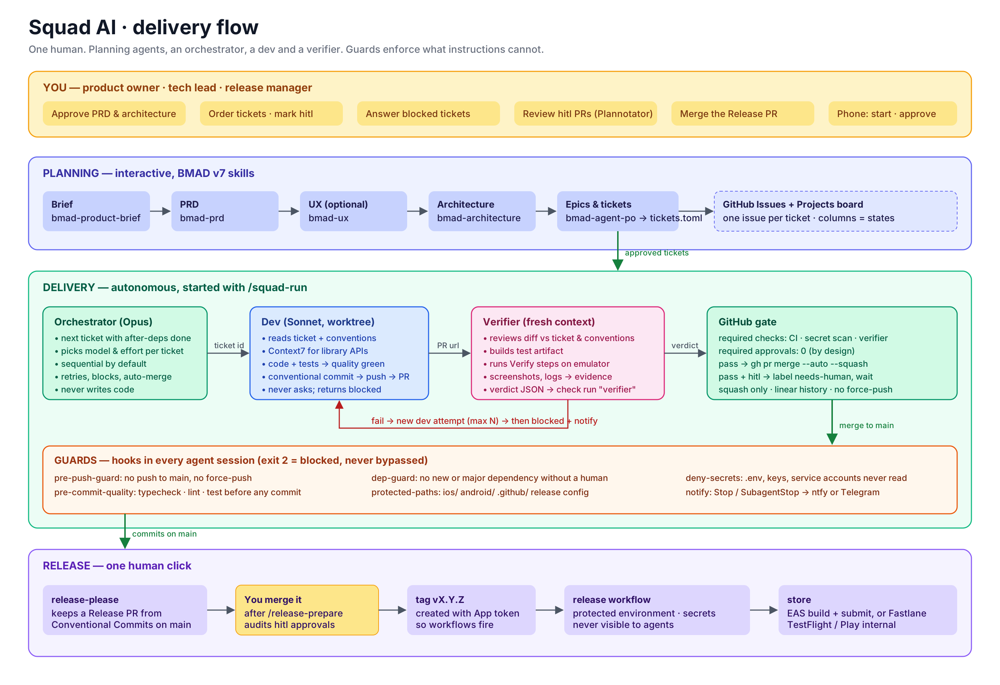

# Squad AI

An autonomous software squad run by one human. You define the product; AI agents plan, implement, verify and deliver, inside the guardrails this repository defines.

This repository holds **only the structure**: the stack-agnostic squad (`plugin/`) and one template per stack (`templates/`). Every project lives in its own repository, created from here. Nothing project-specific is ever committed back.

## How the squad works



*Source: [`docs/squad-flow.svg`](docs/squad-flow.svg).*

Three loops, deliberately separate: **delivery** (ticket → PR → merge), **quality** (verifier → check run) and **release** (tag → store). A merge into `main` never means a release.

### Roles

| Role | Who | Responsibility |
|---|---|---|
| Product owner / tech lead | You | Approve PRD, architecture, ticket order, `hitl` tickets, releases. Answer blocked tickets. |
| Planning agents | BMAD v7 skills | Interview you, write brief, PRD, UX, architecture; slice epics into tickets with `Verify:` steps. |
| Orchestrator | `squad-orchestrator` (Opus) | Pick tickets, choose models and effort, dispatch, retry, block, auto-merge. Never writes code. |
| Dev | `squad-dev` (Sonnet, worktree) | One ticket, one branch, one PR. Never asks; returns `blocked` instead. |
| Verifier | `squad-verifier` (Sonnet, fresh context) | Code review + QA in one pass. Produces evidence and a verdict. Never fixes code. |
| Guards | hooks + GitHub rulesets | Enforce what instructions cannot: no push to main, quality before commit, no majors, no secrets, no native/CI edits. |
| Release | release-please + protected workflow | Tag on your click; store credentials never reach agents. |

### Principles

- **Instructions are requests; hooks are guarantees.** Every rule that matters is a hook or a required check.
- **Verifier ≠ developer.** The agent that judges never saw the implementer's context.
- **Approvals are never required on GitHub.** The verifier's verdict is a status check; auto-merge depends on checks only.
- **Sequential by default.** Parallel agents multiply token spend; the orchestrator decides when it is worth it.
- **Everything is English**, except the conversation with you.
- **Comments are rare.** Code is self-explanatory; human-written comments are never touched.
- **Library docs come from Context7**, then official docs, then the web. Never from memory.

## Repository layout

| Folder | Purpose |
|---|---|
| [`plugin/`](plugin/README.md) | The squad: agents, skills, hooks, settings, workflows, rulesets, universal `AGENTS.md`. Copied into every project. |
| [`templates/mobile/`](templates/mobile/README.md) | React Native conventions and starter files. |
| `templates/web/` | Placeholder. |
| `templates/backend/` | Placeholder. |
| `.claude/skills/squad-init/` | The only skill that runs **here**: creates a new project from this structure. |

## How to use

### Create a project

```
cd <this repo>
claude
/squad-init            # or: /squad-init --brownfield /path/to/existing/repo
```

`squad-init` interviews you (where to create the project, stack, existing documents, which tickets need human review, QA platform, notifications, GitHub owner), then:

1. Lists every tool and credential the project will need and **stops until `scripts/squad-doctor.sh` reports them present**. Credentials are never typed into the chat: you paste them where they belong (GitHub secrets, a protected environment, your shell profile) and the doctor only checks that they exist.
2. Scaffolds the project with the stack's official command (`npx create-expo-app`, `npx @react-native-community/cli init`, …) and commits the untouched boilerplate: `chore: initial commit (<tool> <version>)`.
3. Copies the squad structure and the template, installs the pinned BMAD skills, fills `squad.config.json`, and commits: `chore: apply squad structure (squad-ai <version>)`.
4. Creates the GitHub repository, ruleset, labels and board.

### Plan

```
/discovery-greenfield   # new product: brief → PRD → architecture → tickets
/discovery-brownfield   # existing code: recon → context → "align to template" epic
```

You review each document in [Plannotator](https://github.com/backnotprop/plannotator) and approve or annotate. Mark critical tickets `hitl = true`.

### Deliver

```
/squad-run                       # whole backlog, sequential
/squad-run --ticket APP-12       # one ticket
/squad-run --parallel 2          # when tickets are independent and you accept the token cost
```

The squad does not depend on any particular orchestration or remote UI: run it from a terminal, from Claude Code Remote Control, from Paseo, Orca or whatever you prefer to start sessions and approve permissions from your phone. Blocked tickets and finished runs notify you through the channel in `squad.config.json`.

### Release

```
/release-prepare v1.2.0          # audit merged tickets, check hitl approvals, review changelog
```

Then merge the Release PR on GitHub. The tag triggers the protected release workflow.

## Commit convention

[Conventional Commits](https://www.conventionalcommits.org/en/v1.0.0/#specification) everywhere, enforced by commitlint in CI: `feat`, `fix`, `refactor`, `perf`, `test`, `docs`, `style`, `chore`, `ci`, `build`; `!` for breaking changes; ticket id in the scope (`feat(APP-12): …`). See the [semantic commit cheat sheet](https://gist.github.com/joshbuchea/6f47e86d2510bce28f8e7f42ae84c716#file-semantic-commit-messages-md).

## Status

Phase 0 (structure) is written and the hooks are tested with synthetic payloads. See `plugin/README.md` › *Before first use* for what must be pinned and configured before the first real run.
